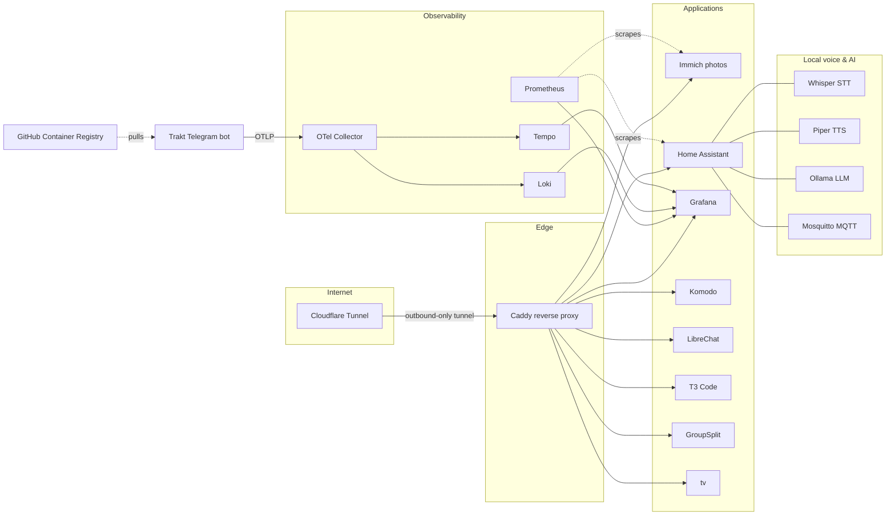

# 🏠 Homelab

Infrastructure-as-code for my single-node homelab: Docker Compose stacks
(plus a self-deploying app stack), published to the
internet through a Cloudflare Tunnel and fully observable with a
Grafana/Prometheus/Loki/Tempo stack.

Everything needed to rebuild the server from scratch lives in this repo.
Pushing to `main` deploys — but CI is no longer the deployer. Komodo checks
this repo out *on the server* and runs `docker compose` there, triggered by a
GitHub webhook. GitHub Actions builds the owned images
(`config-agent`, `t3-code`, and `t3-code-catalog`) and then tells Komodo to deploy, in that order, so an
image is never pulled before it exists; a second job renders the Stack
definitions in `komodo/stacks.toml` and pushes them into Komodo's sync. Only the data stays on the machine, and
each stack's secrets live in a `.env` beside its checkout rather than in GitHub.
For stacks that interpolate those values into Compose, Komodo's normalized
config log can still contain them; LibreChat's secret delivery is not yet
closed out.

## Architecture



No inbound ports are open on the router: `cloudflared` maintains an
outbound-only tunnel to Cloudflare, which routes published hostnames to
Caddy, which reverse-proxies to each service over a shared Docker bridge
network (`internal`). DNS is a wildcard `*.{domain}` CNAME at the tunnel, so
what actually decides whether a hostname is public is the tunnel's own ingress
list (Zero Trust → Networks → Tunnels → Public Hostnames), which ends in
`http_status:404` — publishing a service means adding it *there* as well as in
the Caddyfile. TLS terminates at Cloudflare's edge, so every site block is
`http://` and origins see plain HTTP — an app that decides anything from the
request scheme (secure cookies, redirect URLs) has to be told the real one, and
Caddy overwrites `X-Forwarded-Proto` with the scheme it was reached on unless
`trusted_proxies` says otherwise. The tunnel runs
in its own host-managed compose, separate from every control plane, so no
deploy — CI's or Komodo's — can take down the route used to repair it.

## Stacks

| Stack | What it runs | Why |
|---|---|---|
| [config/](config/) | Caddy 2.8 + config-agent | Reverse proxy for every published service, plus the one container that copies repo config (HA yaml, mosquitto.conf) into the live dirs and pushes UI edits back to git. Deployed by Komodo; CI builds `config-agent` before the shared Komodo deploy action |
| [immich/](immich/) | Immich v3, Postgres (pgvector), Valkey, ML service | Self-hosted Google Photos replacement with on-device ML. Deployed by Komodo from this repo on a GitHub webhook, not by CI |
| [home-assistant/](home-assistant/) | Home Assistant, Mosquitto, Whisper, Piper, Ollama | Smart home with a fully local voice assistant pipeline (STT → LLM → TTS). Deployed by Komodo from this repo on a GitHub webhook, not by CI; `ha-config/` and `mosquitto/` are synced separately by config-agent |
| [monitoring/](monitoring/) | Prometheus, Grafana, Loki, Tempo, OTel Collector, Promtail, cAdvisor, node-exporter | Metrics, logs, and traces for the host and every container. Deployed by Komodo from this repo on a GitHub webhook, not by CI; each service's config is bind-mounted from the checkout rather than baked into an image |
| [tunnel/](tunnel/) | cloudflared | The Cloudflare Tunnel every published service is reached through. Host-managed, never deployed — a bad deploy of the stack holding the tunnel would remove the path used to repair it |
| [komodo/](komodo/) | Komodo Core + Periphery + MongoDB | The control plane: clones this repo on the server and deploys every stack above from it. Host-managed, never CI-deployed |
| [t3-code/](t3-code/) | T3 Code v0.1.5, Codex 0.166.0, Foundry catalog proxy | CI builds both images before Komodo deploys; direct pairing through Caddy/Cloudflare at t3.sussman.win; awaiting authorized rollout |
| [librechat/](librechat/) | LibreChat, MongoDB, Meilisearch | Chat front-end over a Microsoft Foundry deployment. A Komodo-owned stack with checkout-mounted config; secret delivery remains under evaluation |
| [code-interpreter/](code-interpreter/) | LibreChat Code Interpreter v1.10.3 (API, worker, KVM sandbox runner, egress gateway, file and tool-call servers), Redis, Floci S3 | The sandbox behind LibreChat's "Run code" and "Upload to Code Environment": each execution runs in its own libkrun microVM with no network. Only LibreChat can reach it, over `librechat-codeapi`. Deployed by Komodo from this repo on a GitHub webhook |
| [ci-runner/](ci-runner/) | GitHub Actions runner 2.338 (official image + Compose), Docker-in-Docker 29.9 | A self-hosted runner for a private repo, so its Actions jobs run here instead of on GitHub's machines. Jobs get a private Docker daemon, never the server's. Deployed by Komodo from this repo, which also builds the runner image on the server — see [The self-hosted runner](#the-self-hosted-runner-ci-runner) |

Three more stacks run on the server but are deliberately **not** defined here.
The first,
[traktv-tg-bot](https://github.com/lorainemg/traktv-tg-bot) (my Telegram bot
for Trakt.tv + Postgres 17 + Aspire dashboard), generates its compose file
with .NET Aspire and deploys itself from its own repo's CI through the Komodo
API: a `trakt-tg-bot` Stack in `file_contents` mode that CI creates on its
first run if missing, then fills and deploys on every push. CI holds a key for
the `trakt-tg-bot-ci` service user, which has Read + Attach on the server
(what creating a stack there needs — Komodo lets non-admins create stacks
unless `KOMODO_DISABLE_NON_ADMIN_CREATE` is set) and is granted Write on the
stack automatically as its creator. No sync TOML may declare this Stack: sync
resets any field it doesn't declare, and this Stack's contents are CI's.
Beyond that seam this repo only documents it (the monitoring stack joins its
network to collect telemetry). One sharp edge to know: Aspire derives the Postgres volume
name from an apphost hash, so an Aspire CLI update can silently point the stack
at a fresh empty volume — the old data survives under the previous name, and
the fix is naming the volume explicitly in the AppHost.

The second is **group-split** (`group-split-web`, `api`, `keycloak`, Postgres
and an Aspire dashboard), which follows the same pattern from its own repo's
CI. Its Stack is likewise absent from `komodo/stacks.toml` for the same reason
the bot's is, and unlike the bot it *is* published: its `web` container joins
`internal`, so [config/caddy/Caddyfile](config/caddy/Caddyfile) reverse-proxies
`groupsplit.<domain>` to `group-split-web:8080`. That one line is the whole
seam — the compose file, the image tags and the other three containers belong
to that repo. Its Keycloak is not published, so browser-facing login is not
reachable from outside the LAN yet (see [LEARNING.md](LEARNING.md)).

The third is **tv**, a single container (`tv-addon`) in a Stack whose compose
file is written in Komodo's UI and kept nowhere else: no repo holds it and no
CI writes it, so the only copies are Komodo's database and its nightly backups
(`/etc/komodo/backups` on the host). It stays out of `komodo/stacks.toml` for
the same reason as the other two. Komodo pulls its private image with the same
`lorainemg` GHCR account as `config-agent`, and it is the one Stack with Auto
Update on: the nightly Global Auto Update procedure (03:00) redeploys it when
its image tag moves. Like group-split it joins `internal`, and
[config/caddy/Caddyfile](config/caddy/Caddyfile) publishes `tv.<domain>` to
`tv-addon:7000`. Its state lives in the `tv_data` volume.

Highlights:

- **Local voice assistant** — Home Assistant's Assist pipeline wired to
  Wyoming Whisper (speech-to-text), Wyoming Piper (text-to-speech) and a local
  Llama 3.2 model served by Ollama. No cloud round-trip.
- **Full observability** — the Trakt bot ships traces/logs over OTLP to an
  OpenTelemetry Collector that fans out to Tempo, Loki and an Aspire
  dashboard; Prometheus scrapes the host, every container (cAdvisor), Home
  Assistant and Immich; Grafana ties it all together.
- **CI artifact flow through GHCR** — the
  [Trakt bot](https://github.com/lorainemg/traktv-tg-bot)'s and
  [GroupSplit](https://github.com/Sussman-Club/group-split)'s images are built
  by .NET Aspire's deployment pipeline in GitHub Actions and pushed to private
  GHCR packages. Komodo logs the server in with a read-only token before each
  pull; the account is declared in `komodo/registries.config.toml` and the
  token lives only in the host's `komodo/.env`.

## Repo layout

```
├── .agents/skills/   agent-readable runbooks (adding-a-stack); .claude/skills symlinks here
├── .github/workflows/deploy.yml   build config-agent → tell Komodo to deploy
├── config/           docker-compose.yml, .env.example
│   ├── caddy/        Caddyfile, mounted into Caddy straight from the checkout
│   └── config-agent/ the one config container: repo → live sync + hourly UI-edit backup
├── immich/           docker-compose.yml, .env.example
├── home-assistant/   docker-compose.yml, .env.example
│   ├── ha-config/    HA yaml config (automations, scripts, scenes, ...)
│   └── mosquitto/    mosquitto.conf (passwd file is generated, not committed)
├── monitoring/       docker-compose.yml, .env.example
│   ├── prometheus/   prometheus.yml, entrypoint (HA token via env)
│   ├── promtail/     promtail.yml
│   ├── tempo/        tempo.yml
│   └── otelcol/      otel-collector.yml
├── registry/         docker-compose.yml (retired 2026-09; kept until the old volume is deleted)
├── tunnel/           docker-compose.yml (cloudflared), .env.example
├── komodo/           docker-compose.yml (Core + Periphery + Mongo), registries.config.toml, .env.example
├── t3-code/          docker-compose.yml, .env.example, server/, catalog/, pair.py
├── librechat/        docker-compose.yml, config/librechat.yaml, .env.example (deployed by Komodo)
├── code-interpreter/ docker-compose.yml, .env.example (LibreChat's code sandbox, deployed by Komodo)
├── ci-runner/        docker-compose.yml, runner/ (Dockerfile, entrypoint, job hook), .env.example (Actions runner, built and deployed by Komodo)
└── scripts/          bootstrap.sh, codeapi-secrets.sh, pre-commit (gitleaks)
```

Conventions:

- **Config mounted from the checkout, state on disk.** Komodo clones this repo
  onto the server, so pure config (Prometheus/OTel/Promtail/Tempo, the
  Caddyfile) is bind-mounted straight out of the checkout — nothing is built
  and no container is recreated between an edit and the process reading it.
  Always mount the *directory*, never the file: `git pull` replaces files, and
  a single-file bind mount stays pinned to the original inode forever, serving
  stale config while the host's checkout looks up to date. Config that has to
  sit next to runtime state the app writes itself (HA yaml, mosquitto.conf) is
  still *copied* in by `config-agent`. Stateful directories (photo library, HA
  runtime, Ollama models, databases) live under a data root (`/data` by
  default).
- **Secrets never in git.** Each stack's secrets live in a `.env` beside its
  checkout on the server (`/etc/komodo/stacks/<stack>/<stack>/.env`, root-owned
  `600`), placed once by hand and never transmitted. GitHub Actions holds only
  what CI itself needs: `KOMODO_URL` and an API key for the `homelab-ci`
  service user, which can write the `homelab` sync and deploy the `config`
  stack, nothing else (see the CI/CD section for why that is not nothing). The one
  file-based secret (Prometheus's HA token) is materialized at container start
  from an env var by its entrypoint. A gitleaks pre-commit hook backstops it.

## Rebuilding from scratch

1. Install Docker Engine + the Compose plugin; mount/create the data disk at
   `/data`.
2. Restore the data directories from backup (Immich library + DB, HA config,
   etc.) — or start fresh.
3. Create the shared network, then start the tunnel and the control plane —
   the tunnel first, since everything else is published through it. Copy
   `tunnel/.env.example` to `tunnel/.env` and fill in the tunnel token, then
   `docker network create internal && docker compose --project-directory tunnel up -d && docker compose --project-directory komodo up -d`.
   Point the tunnel's public hostnames — `komodo.<domain>`, `immich.<domain>`,
   `grafana.<domain>`, … — at `http://caddy:80`.
4. Set the repo's Actions secrets: `KOMODO_URL`, and
   `KOMODO_API_KEY` / `KOMODO_API_SECRET` for a `homelab-ci` service user
   created by hand in Komodo with Write on the `homelab` sync and Execute on
   the `config` stack, nothing else. That is everything CI needs — every other
   secret lives on the host now. The server's LAN address is not a secret and
   is stated inline in `deploy.yml`'s `vars` input.
5. The Stacks themselves need no clicking: bootstrap rendered
   [komodo/stacks.toml](komodo/stacks.toml) (a template — `${HOMELAB_LAN_IP}`
   comes from the environment you ran bootstrap with) into the `homelab`
   ResourceSync's contents and
   ran the first sync, which creates every Stack with its `project_name` **exactly** the
   directory name — so an existing server's volumes (`<project>_<volume>`) are
   adopted rather than recreated empty. The `trakt-tg-bot` Stack is the
   exception: its own repo's CI creates it on first run (see above), which
   needs the `trakt-tg-bot-ci` service user recreated by hand with an API key
   and Read + Attach on the server. Per-stack deploy behaviour
   (`webhook_force_deploy`, `post_deploy` restarts for processes that don't
   hot-reload their config) lives in that file too. What remains by hand:
   copy each stack's `.env.example` to
   `/etc/komodo/stacks/<stack>/<stack>/.env` and fill it in (except
   `code-interpreter`'s, and the Code Interpreter half of `librechat`'s: run
   `scripts/codeapi-secrets.sh` on those two files instead, since they share
   one keypair), deploy each Stack, and add the GitHub webhooks — one per stack at
   `<KOMODO_URL>/listener/github/stack/<name>/deploy` (secret:
   `KOMODO_WEBHOOK_SECRET`, from `komodo/.env` — CI does not hold it, only
   GitHub's per-stack webhooks use it). The sync needs no webhook: the
   `sync-komodo` job in `deploy.yml` re-renders and re-runs it on every push
   that touches `stacks.toml` or `deploy.yml`. `ci-runner`'s `.env` holds a
   registration token that expires an hour after GitHub issues it, so fetch
   it right before deploying that Stack; the runner registers itself on
   first start and the token can then be deleted.
6. Mosquitto users are the one manual step:
   `docker exec mosquitto mosquitto_passwd -c /mosquitto/config/passwd homeassistant`
7. LibreChat accounts are the other one. Registration is disabled on a
   public hostname, so the first account is made from the host with
   `docker exec -it librechat npm run create-user` — there is never a window
   where the login page accepts signups.

`HOMELAB_LAN_IP=<server LAN address> ./scripts/bootstrap.sh` automates steps 3
and 5's Komodo half: it creates the shared network, refuses to start if
`tunnel/.env` or `komodo/.env` is missing, brings up those two stacks, then
seeds the control plane — the ResourceSync holding `komodo/stacks.toml`,
rendered through the same client the CI actions use (`python3` and `jq` are
its only prerequisites), and runs the first sync, which creates every Stack. Steps 4-6's remaining hand work
(`.env` files, webhooks, Mosquitto users) finishes the rebuild. If you need a stack up with no
control plane at all — Komodo itself broken, say — its compose file still runs
standalone: `docker compose --project-directory <stack> up -d`, with that
stack's `.env` beside it.

LibreChat's `config/` directory is mounted from the Komodo checkout and
`CONFIG_PATH` points at its YAML file. A config-only commit therefore needs the
forced webhook and post-deploy restart described above.

Home Assistant's HACS custom components (`better_thermostat`, `browser_mod`,
`extended_openai_conversation`, `hacs`, `monitor_docker`, `roborock_custom_map`,
`smartrent`, `teamtracker`, and friends) are reinstalled through
[HACS](https://hacs.xyz/) rather than committed — the 128 MB of vendored
code doesn't belong in git.

## Contributing to it (a.k.a. me, later)

Adding a new stack — or moving one between deploy methods — is written up in
[.agents/skills/adding-a-stack/SKILL.md](.agents/skills/adding-a-stack/SKILL.md):
a decision table for the four methods, a checklist per method, and the traps
that have already caught us. It's in the cross-vendor `.agents/skills/` location
so Codex and Copilot load it too; `.claude/skills` is a symlink to it.

Enable the secret-scanning hook once per clone:

```sh
cp scripts/pre-commit .git/hooks/pre-commit && chmod +x .git/hooks/pre-commit
```

## CI/CD ([deploy.yml](.github/workflows/deploy.yml))

Most pushes to `main` never touch a runner. Komodo holds one GitHub webhook per
stack; a push makes it pull this repo on the server and run `docker compose up
-d` for that stack, so a config edit reaches the running container with no build
and no image in between.

CI exists for two things that still need a runner. The first is building
`config-agent`, one job:

1. **Change detection** — [dorny/paths-filter](https://github.com/dorny/paths-filter)
   checks `config/config-agent/**`. If it's untouched, every later step is
   skipped and the run is green having done nothing.
2. **Image build** —
   [docker/build-push-action](https://github.com/docker/build-push-action)
   rebuilds and pushes `ghcr.io/lorainemg/homelab/config-agent` (tagged
   `latest` + commit SHA for rollbacks).
3. **Deploy trigger** — the `deploy-stack` action asks Komodo's API to deploy
   the `config` stack, in the same job and strictly after the build, so Komodo
   can never pull an image GHCR doesn't have yet. It then polls the resulting
   Update until it finishes, so a green step means the stack came up — unlike
   the signed webhook this replaced, which answered `200` on acceptance and
   never reported an outcome.

`workflow_dispatch` rebuilds and redeploys unconditionally — the
fresh-server / changed-agent button.

The second job, `sync-komodo`, is how the Stack definitions reach Komodo.
Komodo never reads `komodo/stacks.toml` from the repo: the file is a template,
because Komodo's `links` field cannot reference a variable. The `run-sync`
action renders it — `${HOMELAB_LAN_IP}` comes from the step's own `vars` input,
so an address that appears in every LAN link is written once per workflow —
pushes the result into the `homelab` ResourceSync as its contents, runs the
sync and waits for the result. It re-declares the sync's source fields
(`repo`, `branch`, `resource_path`) empty on every run, because Komodo prefers
a repo over its stored contents and would otherwise ignore what CI just
pushed. It runs when `stacks.toml` or `deploy.yml` changed (the LAN address
lives in the workflow, so editing it must re-run the sync), or on
`workflow_dispatch`. Chosen on 2026-09-03 over committing a rendered copy back
to the repo, to keep a single `stacks.toml` in git.

The deployment and sync jobs hold the same Komodo API key: the `homelab-ci` service user has Write
on the `homelab` sync and Execute on the `config` and `t3-code` stacks. The sync
defines every Stack, `post_deploy` commands included, so treat that key as the
most valuable secret in this repo. CI no longer holds `KOMODO_WEBHOOK_SECRET` —
the per-stack GitHub webhooks Komodo listens on still use it, but nothing in a
workflow does.

Neither job hand-rolls any of that. `.github/actions/komodo/` holds three
composite actions — `deploy-stack`, `update-stack`, `run-sync` — over one
tested Python client (`client/komodo.py` and `client/cli.py`, standard library
only, fully type-annotated; `client/tests/` and a strict `mypy` pass run by
[test-actions.yml](.github/workflows/test-actions.yml) against a stub Komodo).
The [trakt bot repo](https://github.com/lorainemg/traktv-tg-bot) uses the same
actions cross-repo, which is why authentication, the create-if-missing probe
and the Update-polling loop exist once rather than twice.

Config that can't simply be mounted flows through the `config-agent` container
in the config stack. HA yaml and `mosquitto.conf` are mounted read-only from
Komodo's checkout at `/src` and copied into the live dirs (keeping the previous
version in `.sync-backup/` next to each), because Home Assistant writes to those
same directories itself; HA is then reloaded — or restarted, when
`configuration.yaml` changed — through its API. The Caddyfile no longer goes
through the agent at all: Caddy mounts `config/caddy/` from the checkout and
`--watch` reloads it in place, so a Caddyfile edit never recreates the caddy
container and can't sever the tunnel → caddy → Komodo path a deploy's own
response travels through. Editing the config stack's compose file itself — a
caddy version bump, say — does recreate it, and that one deploy is expected to
lose its response.
The flow is two-way: the same agent commits UI-made edits (automations,
scripts, scenes, helpers) back to this repo once an hour with `[skip ci]`,
so nothing is lost between deploys. Runtime state (`.storage/`, databases,
`custom_components/`, Mosquitto's `passwd`) is never touched — back that
layer up with HA's built-in automatic backups.

### The self-hosted runner (`ci-runner`)

Everything above runs on GitHub's machines, and stays there. `ci-runner` is for
a different, private repo whose jobs run on this server instead. The runner
dials out to GitHub and waits for work, so nothing is published and the tunnel
is not involved. This repo's own CI never uses it, for two reasons: this repo
is public, and a runner that a public repo can use runs code from strangers'
pull requests; and the runner is a Stack the sync defines, so CI that depended
on it could not repair it.

- **Jobs get their own Docker.** `dind` is a private, privileged dockerd. The
  runner reaches it through a socket in a shared volume and shares its network
  namespace, so a job that publishes a port on `127.0.0.1` can fetch it. Jobs
  cannot see the server's containers, but privileged means a fence, not a
  wall: whoever can push workflows to the served repo should be trusted like
  root here. dind's bridge and job networks live in `10.200.0.0/24` and
  `10.201.0.0/16`, because its defaults collide with the LAN and break DNS.
- **Registered once.** On first start the runner trades the one-hour token in
  `.env` for its own credentials, kept with its install in the `runner-home`
  volume. The only credential left on the server can do nothing but take that
  repo's jobs. Lose the volume, or leave the runner offline for 14 days (GitHub
  then deletes it), and it needs a fresh token in `.env`; `--replace` takes
  over the old entry.
- **Every job starts clean.** One long-lived runner means a job inherits the
  last one's leftovers, so a job-started hook empties dind first: no
  containers, volumes, networks or images. Only build cache survives, capped at
  10 GB. An unchanged image rebuilt in about 5 s in testing.
- **Capped.** dind gets 4 CPUs and 4 GB (every job container runs inside it),
  the runner 2 CPUs and 2 GB.
- **No fallback.** While the server is down, a job aimed at this runner waits,
  for up to 24 hours, then fails. It does not fall back to GitHub's runners.

The `build-t3-code` job follows the same shared deployment convention. It depends
on `sync-komodo`, detects `t3-code/server/**` and `t3-code/catalog/**`, publishes
both images with latest/SHA tags, then runs `deploy-stack`. Compose-only changes
run the deployment step without rebuilding. This ordering prevents a deployment
from pulling an image before it exists or targeting a Stack not yet synced.

## T3 Code remote development

The stack runs standalone T3 v0.1.5 and Codex 0.166.0 as UID/GID 1000. Caddy
routes `t3.sussman.win` to `t3-code:3773` on the shared `internal` network;
Cloudflare Tunnel terminates public HTTPS and forwards to Caddy, as for the
other apps. There is no published host port or Docker socket. Clients pair
with the HTTPS address and a one-time code; a T3 Connect account is optional
and is not required for this route. Docker restart policy replaces host service
installation.

Codex uses the Foundry Responses endpoint for inference. Its separate
`model_catalog_url` points to the private `catalog` container, which translates
Foundry project `/deployments?api-version=v1` into Codex's native metadata.
Each authenticated catalog request fetches current deployments. There is no
adapter polling, cooldown, cache, or manual-refresh endpoint; Codex owns its
client cache and request timing. Catalog has its own bridge and no Caddy route.

Deployment names come from Foundry. The catalog image extracts native metadata
from the same pinned Codex release during its build (`codex debug models
--bundled`); no model template is maintained in this repository. The proxy
filters on Foundry's chat-completion capability and matches its `modelName`
to that bundled metadata, preserves the deployment
name as the model ID, and labels it `foundry-<deployment>`. Luna and Sol work
this way. Models absent from Codex's bundled catalog are omitted rather than
assigned guessed capabilities; this includes the resource's older GPT-5.2,
embedding and Decision deployments. T3 v0.1.5 capitalizes labels in its picker.

Persistent paths under `${DATA_ROOT:-/data}/t3-code`:

- `home/` → `/home/t3`: T3 identity, paired sessions, SQLite history, Codex state
  and downloaded tools. T3 uses `.t3`; Codex uses `.codex`.
- `workspace/` → `/workspace`: repositories and working files, independent of
  Komodo's disposable checkout.
- `secrets/` → read-only `/run/credentials` in both containers: `foundry-token`.
  The token is read at runtime, never interpolated into Compose or committed.
  T3 passes it to its Codex child processes; administrators of the host can
  still access it. Restart both services after rotating the file.

### First rollout — requires authorization

Opening the PR or running local checks does not deploy. Merging to `main`
changes the live Caddy config, applies ResourceSync, and builds/deploys T3, so
prepare its host state and authorize the rollout before merging.

1. Prepare `/data/t3-code/home`, `workspace`, and `secrets` on the server with
   owner 1000:1000. Restrict `home` and `secrets` to 700. Write the Foundry token
   privately into `secrets/foundry-token`, owner 1000:1000 and mode 400. Do not
   pass its value on a shell command line or paste it into Komodo's UI.
2. Pre-clone the Stack checkout if needed, and place the non-secret settings
   from `t3-code/.env.example` in
   `/etc/komodo/stacks/t3-code/t3-code/.env`, root-owned mode 600. The project
   URL and inference URL are separate required settings. Choose the default
   deployment with `CODEX_MODEL`.
3. Before the authorized merge, create an undeployed Komodo Stack shell named
   `t3-code`, server `Local`, project name `t3-code`, and grant `homelab-ci`
   Execute on that Stack. After the merge, ResourceSync fills its configuration.
   CI waits for ResourceSync, builds both images, then uses the shared Komodo
   deploy action, which waits for the resulting Update. Do not add a direct
   GitHub Stack webhook that could race these builds. The Stack logs into GHCR
   with the existing `lorainemg` registry account to pull both images; verify
   that account can read the new packages. Compose-only edits use the same
   deploy action without rebuilding.
4. In the existing Cloudflare Tunnel dashboard, add `t3.sussman.win` targeting
   `http://caddy:80`. The token-managed tunnel's hostname mapping lives in
   Cloudflare, so this remains a manual step. The committed Caddyfile already
   includes the T3 route and hot-reloads through the existing config webhook.
5. On the server run:

   ```sh
   python3 /etc/komodo/stacks/t3-code/t3-code/pair.py
   ```

   Open the printed HTTPS pairing URL or enter its address/code in the T3
   desktop/mobile client. It grants the default owner scopes and expires after
   five minutes; generate a fresh code per new device. Reconnects use the saved
   session. The helper substitutes the public address for Docker's private
   address without changing the one-time token. No Connect account is needed.
6. Add a repository under `/workspace`, select Codex and a Foundry model, and
   run a small task from another PC and a phone on cellular. Recreate the T3
   container and verify the environment identity, saved session, thread history,
   model list and working files survive. Revoke a test client under Sharing &
   access and confirm it must pair again.

Back up `home` and `workspace`; stop T3 while snapshotting its SQLite state.
Restore ownership and paths. Never copy this home to create another running
machine: it contains identity and sessions. Keep the runtime token separately
in a secret store. Upgrade pinned T3/Codex through image
builds (keep the Codex version in both Dockerfiles aligned); do not self-update inside the container. Rollback sets both `T3_IMAGE`
and `CATALOG_IMAGE` to the same previous CI SHA in host `.env`, then deploys.
Browser automation needs additional Linux libraries and sandbox acceptance;
it is not covered by the verified text-agent setup.

### Local validation

The optional override builds the exact production images and publishes T3 only
at `127.0.0.1:3774`. Prepare local state and token as above, set `DATA_ROOT` in
a gitignored `t3-code/.env`, then:

```sh
docker compose -f t3-code/docker-compose.yml -f t3-code/compose.local.yml up -d --build
python3 t3-code/pair.py --url http://127.0.0.1:3774
PYTHONDONTWRITEBYTECODE=1 python3 -m unittest discover -s t3-code/catalog
```

The helper uses the same project/service for local and Komodo deployments.
Stop locally with both Compose files and `down`; bind-mounted state stays on
disk. Neither the local override nor its settings are referenced by Komodo.

Verified locally: standalone Linux runtime and checksum, non-root Docker
startup, live Foundry inference through Codex and T3, both model labels, direct
catalog requests, authenticated WebSocket upgrade through Caddy, and persistent
identity/workspace after recreation. The
Foundry project API accepted the supplied resource key for deployment listing;
this was tested rather than assuming management login was required. Public
Cloudflare routing, phone pairing/reconnect, live deployment changes in an
already-open picker, and browser automation remain rollout acceptance checks.

Upstream evidence:
[standalone Linux release](https://github.com/pingdotgg/t3code/releases/tag/v0.1.5),
[direct remote pairing](https://github.com/pingdotgg/t3code/blob/v0.1.5/docs/user/remote-access.md),
[Codex catalog configuration](https://developers.openai.com/codex/config-reference/),
[Foundry deployment-list SDK](https://github.com/Azure/azure-sdk-for-python/blob/main/sdk/ai/azure-ai-projects/azure/ai/projects/operations/_operations.py).
No T3-maintained standalone Docker server image was found in the checked
upstream docs/workflows. Docker's official `sbx/t3code-kit` installs T3 into an
agent sandbox for desktop-managed SSH; this stack uses its own standalone image.

Foundry's model-detail API was checked for Luna and Sol: it supplies general
inference/chat/embedding flags, not reasoning levels, context limits or Codex
shell/tool metadata. The documented [AI Inference `/info` API](https://learn.microsoft.com/en-us/python/api/azure-ai-inference/azure.ai.inference.chatcompletionsclient?view=azure-python-preview)
is not supported for Azure OpenAI endpoints and only exposes basic model identity.
No documented endpoint supplying the complete Codex catalog was found; using
Codex's bundled metadata avoids maintaining a duplicate template in this repo.
